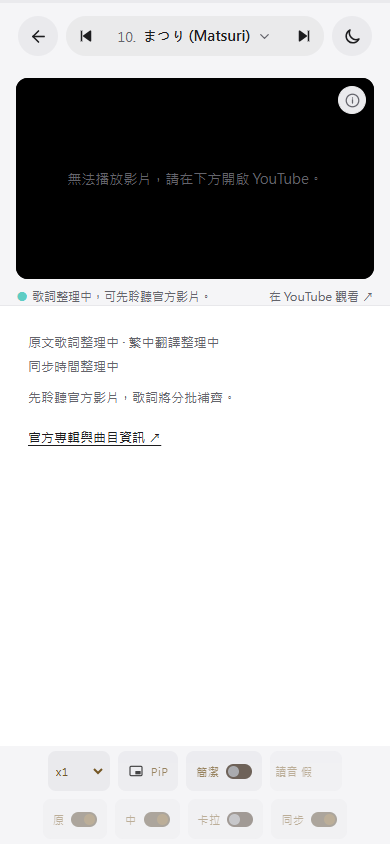
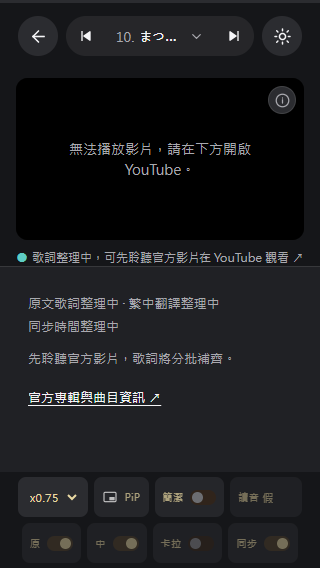

# 藤井風歌曲預習：真實瀏覽器視覺驗證

2026-10-29（Asia/Taipei），本機 2.0.0 建置快照。使用 Playwright Core 1.61.1 操作實際 Microsoft Edge Chromium 155.0.4283.62，無頭模式、獨立未登入工作階段。

**67 項檢查：64 項通過、3 項畫面改善點；18 張驗收截圖。** 本次僅新增驗證產物，未修改應用程式、版本或發佈設定。19 首皆維持歌詞、翻譯及同步時間整理中，沒有可實際練唱的歌詞與已核實應援段落。

後續修正紀錄：下列為當時固定快照的結果。影片失敗後已另查證數字 IP 來源問題，並完成 19 首真實播放；見 [嵌入問題修正紀錄](../embed-investigation-2026-10-29/README.md)。

## 範圍與版本

- 桌面 1440 × 1000；手機模擬 390 × 844；窄螢幕 320 × 568；橫向 844 × 390；平板尺寸 768 × 1024。皆為 CSS 像素，DPR 1。
- 檢查首頁入口、座位圖展開、19 首歌曲預習、搜尋與排序、英文／日文播放器、選歌視窗、上一首／下一首、深淺色、簡潔模式、倍速設定、鍵盤焦點、待確認歌單、舊連結及離線重整。
- 工作期間共用建置目錄有更新，因此最終證據取自固定快照；檔案 SHA-256 見 [build-manifest.json](build-manifest.json)。入口為 `index-D7JX3zIh.js`，樣式為 `index-Dr1fVA_Q.css`。
- 主要操作使用固定快照的 Vite 預覽 `127.0.0.1:4175`；離線複驗使用相同檔案的純靜態 HTTP 服務 `127.0.0.1:4176`。本報告不涵蓋其後的原始碼更新。

## 流程結果

| 步驟 | 操作 | 結果與證據 |
| --- | --- | --- |
| 1 | 首頁進入預習、展開座位圖 | 正常。入口可見，收合資訊為 inert，座位圖展開後成功載入。截圖 01、02、09。 |
| 2 | 19 首清單、搜尋及排序 | 正常。兩個專輯、19 首；Matsuri 搜尋命中〈まつり〉，無結果提示、清除與排序 pressed 狀態正常。手機搜尋 16px。截圖 03、10。 |
| 3 | 英文／日文播放器、歌曲切換 | 路由與待補狀態正常。19 首逐一核對官方影片連結；英文隱藏日文讀音，日文保留停用讀音控制，未備妥功能停用，未來源化應援控制隱藏。淺色影片錯誤提示有 F1。截圖 04、06、11、13。 |
| 4 | 選歌視窗與鍵盤 | 正常。搜尋、清空、選歌、Escape、焦點返回、Tab／Shift+Tab 循環及 2px 可見焦點框通過。截圖 05、12、17。 |
| 5 | 主題、簡潔與倍速設定 | 正常。深淺色可切換且重整後保存；簡潔模式可切換；0.75 倍設定更新無障礙名稱並跨歌曲保留。未驗證實際音訊倍速。截圖 06、07、13。 |
| 6 | 窄螢幕、橫向及平板 | 頁面無水平溢出，390px 狀態訊息未遭工具列遮住。320px 有 F2；同步資訊按鈕有 F3。橫向可用左右分割。截圖 11、14、15、16。 |
| 7 | 正式歌單與舊歌曲網址 | 正常。歌單明示待確認並提供預習入口，沒有防劇透閘門；舊網址顯示指南已轉換。截圖 08。 |
| 8 | 離線重整與選歌 | 相同快照的純靜態服務通過。Service Worker 已接管，歌曲頁可重新開啟、19 首可導覽，離線提示說明影片無法播放。截圖 18。 |

## 已確認的改善點

### F1 · 中：淺色影片錯誤提示對比不足

重現：淺色模式開啟任一歌曲，等待影片回報錯誤。黑色播放器底上的 14px 文字是 `rgb(100,100,107)`，實測對比 **3.58:1**。一般文字的 AA 門檻為 4.5:1，這個錯誤訊息未達門檻；深色模式同訊息為 8.98:1。[W3C 對比規範說明](https://www.w3.org/WAI/WCAG22/Understanding/contrast-minimum.html)

影響：影片無法播放時，使用者不易讀到替代操作。建議讓黑色影片底上的狀態文字保持足夠明亮，不直接沿用淺色頁面的 muted 色。相關樣式在 `src/theme.css` 的 `.video-frame .video-status` 與 `--stage-muted` 映射。



### F2 · 中：320px 提示文字與 YouTube 連結重疊

重現：320 × 568、〈まつり〉、一般模式。影片下方「歌詞整理中，可先聆聽官方影片。」與「在 YouTube 觀看」位於同一列，實際文字範圍右緣為 212px，連結左緣為 198.875px，**重疊 13.125px**。頁面沒有水平捲動，單靠 scrollWidth 檢查無法發現。

影響：主要替代觀看入口與狀態說明混在一起。建議窄寬度允許換行，或把外部連結放到獨立一列；相關樣式為 `src/base.css` 的 `.lyrics-note`、`.lyrics-note-copy` 及 `.watch-on-yt`。



### F3 · 低：同步資訊按鈕小於專案觸控目標

影片右上資訊按鈕實際為 **28 × 28px**，小於 `DESIGN.md` 的 40–44px 觸控目標，手機較難點選。建議擴大可點區，保留圖示大小。相關樣式為 `src/base.css` 的 `.karaoke-source-popover summary`。

此處是專案可用性要求的落差；28px 不應直接判定為 WCAG 2.2 的 24px 最小目標尺寸違規。[W3C 目標尺寸規範說明](https://www.w3.org/WAI/WCAG22/Understanding/target-size-minimum.html)

## 證據限制與環境差異

- 本工作階段的 YouTube iframe 有回報無法播放。已驗證錯誤提示、外部影片連結與設定操作；未證實影片成功播放、音訊、暫停、實際倍速、逐句同步或卡拉 OK。未登入或繞過 YouTube 驗證，也未以模擬播放器代替。
- 所有曲目仍無已準備的歌詞，因此本輪不能驗證實際跟唱、翻譯、日文讀音與應援段落是否正確；停用狀態通過不代表內容已完成。
- Vite 預覽的 CSS／JS 回應帶有 `Vary: Origin`。離線時曾發生已列入快取的入口資產未被套用；相同凍結檔案改用純靜態服務後可正常離線。這支持預覽回應差異影響快取命中的判斷，但尚未對正式主機驗證。診斷見 [preview-offline-diagnostic.json](preview-offline-diagnostic.json)，不列入三項產品畫面缺陷。
- 行動版採 Chromium 觸控與尺寸模擬，沒有驗證實機 iOS Safari、Android Chrome、原生安裝、系統字級放大、讀屏、PiP 小窗或完整 WCAG 符合性。
- 桌面一般流程與補充檢查皆未記錄應用程式 JavaScript 例外。外部影片請求中止不視為本機應用程式例外。
- 本輪驗證視覺及互動，沒有重新查核演出公告內容。

## 截圖索引

下列 18 張為同一建置快照的已檢視截圖；上述 F1、F2 已直接呈現對應畫面。

| 編號 | 畫面 | 短評 |
| --- | --- | --- |
| [01](01-desktop-home.png) | 桌面首頁 | 主要入口與非官方身分清楚。 |
| [02](02-desktop-seat-map.png) | 座位圖展開 | 圖片成功載入，內容可捲動。 |
| [03](03-desktop-guide.png) | 桌面歌曲清單 | 搜尋及專輯分組清楚。 |
| [04](04-desktop-english-player.png) | 英文播放器 | 待補狀態清楚；錯誤提示有 F1。 |
| [05](05-desktop-song-picker.png) | 桌面選歌搜尋 | 過濾結果與輸入焦點正常。 |
| [06](06-desktop-japanese-dark.png) | 日文深色播放器 | 待補讀音控制停用，深色狀態文字可讀。 |
| [07](07-desktop-compact.png) | 簡潔模式 | 模式切換正常，未誤顯示已隱藏歌詞。 |
| [08](08-desktop-pending-setlist.png) | 歌單待確認 | 預習與正式歌單的區別清楚。 |
| [09](09-mobile-home.png) | 手機首頁 | 390px 入口可見，資訊無水平溢出。 |
| [10](10-mobile-guide.png) | 手機歌曲清單 | 長歌名可換行，搜尋維持標籤。 |
| [11](11-mobile-japanese-player.png) | 手機淺色播放器 | 對應 F1、F3。 |
| [12](12-mobile-song-picker.png) | 手機選歌視窗 | 目前歌曲可辨識，清單可捲動。 |
| [13](13-mobile-japanese-dark.png) | 手機深色播放器 | 主題與 0.75 倍設定正常。 |
| [14](14-small-mobile-player.png) | 320px 播放器 | 對應 F2，歌名以省略號顯示。 |
| [15](15-mobile-landscape-player.png) | 手機橫向 | 影片／狀態左右分割，控制可見。 |
| [16](16-tablet-player.png) | 768px 平板尺寸 | 影片、狀態與底部控制分開。 |
| [17](17-mobile-keyboard-focus.png) | 鍵盤焦點 | 選歌關閉鈕有可見焦點。 |
| [18](18-mobile-offline.png) | 離線歌曲頁 | 快取內容與離線提示可見。 |

## 重跑方式

[check-browser.mjs](check-browser.mjs) 為 54 項主要流程；[check-details.mjs](check-details.mjs) 為 13 項補充檢查。兩者需傳入現有 Playwright 或 Playwright Core 的 ESM 入口，不新增專案套件。`KAZE_QA_BASE_URL` 指定待測本機網址。

```powershell
$env:KAZE_QA_BASE_URL = 'http://127.0.0.1:4176/'
node artifacts/browser-qa-2026-10-29/check-browser.mjs '<Playwright Core index.mjs 的絕對路徑>'
node artifacts/browser-qa-2026-10-29/check-details.mjs '<Playwright Core index.mjs 的絕對路徑>'
```

原始結果：[results.json](results.json)、[details.json](details.json)。執行器會列出失敗檢查並保存在 JSON；有失敗檢查或例外時以退出碼 1 結束。可用 [serve-snapshot.mjs](serve-snapshot.mjs) 在 4176 端口提供固定資料夾的純靜態本機預覽。

建議優先修正 F1、F2，再擴大 F3 的點擊區；完成後以相同尺寸複驗。
