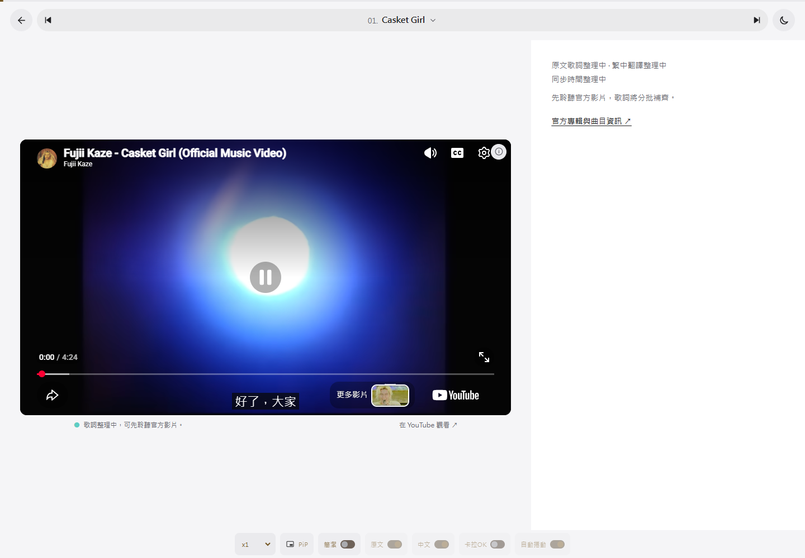
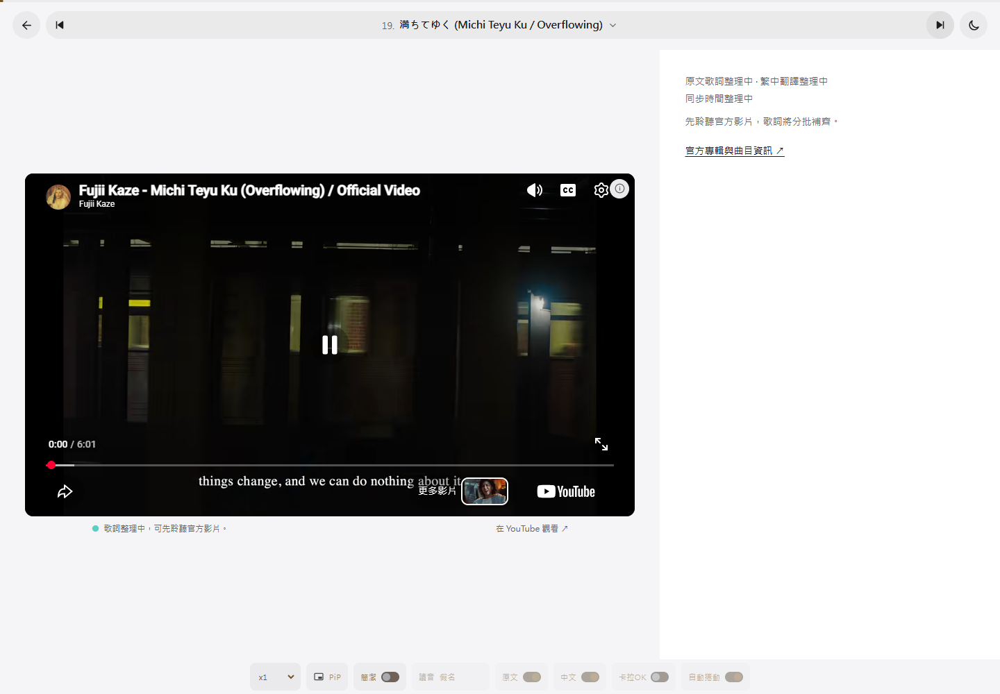
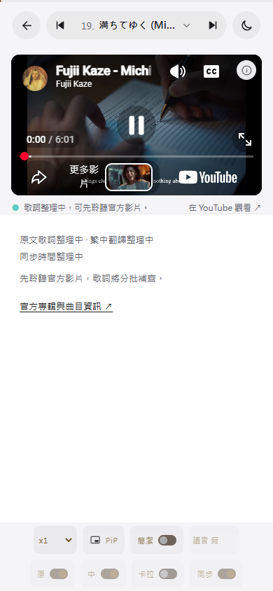

# YouTube 全站嵌入失敗：原因與修正

2026-10-29，Asia/Taipei。**已修正，19／19 首實際播放成功；43 項播放器瀏覽器回歸通過。**

本次問題來自本機預覽的數字 IP 來源 `http://127.0.0.1:4174`。先前只根據錯誤 150 推斷影片禁止嵌入，沒有比對來源及驗證播放，該結論不成立。

## 如何確定原因

相同 Edge Chromium、相同網路、相同影片 `ptiK8U4WlSc`，使用相同的 YouTube IFrame API 與播放呼叫，只更換測試頁的來源：

| 頁面來源 | 實際 Referer | 結果 |
| --- | --- | --- |
| `http://127.0.0.1:4174` | `http://127.0.0.1:4174/` | YouTube 150，影片時間 0，readyState 0 |
| `http://localhost:4174` | `http://localhost:4174/` | 播放成功，4.63 秒，readyState 4 |
| `http://guide.test` | `http://guide.test/` | 播放成功，4.70 秒 |
| `https://guide.test` | `https://guide.test/` | 播放成功，4.69 秒 |

`.test` 為在瀏覽器中本機提供 HTML 的受控測試來源，用於隔離 hostname／協定因素，不是已部署網站。YouTube 回應未替換。另已直接從真實 localhost HTTP 伺服器開啟完整網站，確認影片持續播放，見 [localhost-playback.json](localhost-playback.json)。

IP 測試也有送出 Referer；問題是此來源的播放被拒絕，而不是缺少標頭。上述結果是本輪可重現的實測，不把它擴張為所有網路、地區或影片永遠相同的 YouTube 規則。[來源對照原始結果](origin-comparison.json)

## 為何 marumaru 可以嵌入

[使用者提供的 marumaru 頁面](https://www.marumaru-x.com/japanese-song/play-wzrv48xlr3) 使用 **Video.js 的 YouTube 播放技術層**。其程式仍呼叫 `new YT.Player(...)`，最後的 iframe 仍是 `https://www.youtube.com/embed/ptiK8U4WlSc`，與本站是同一支官方影片。

差別在於 marumaru 的實際頁面來源為 `https://www.marumaru-x.com`。本輪在其公開頁面操作網站自己的播放按鈕，也確認相同影片持續播放：1.01 秒、未暫停、readyState 4、總長 361.761 秒。它的成功不代表必須增加 Video.js；本站既有 IFrame API 在 localhost 已能播放相同影片。[marumaru 播放與技術紀錄](marumaru-playback.json)

[YouTube 官方來源識別要求](https://developers.google.com/youtube/terms/required-minimum-functionality#embedded-player-api-client-identity) 要求嵌入客戶端提供來源識別，並建議 `strict-origin-when-cross-origin`。本次維持瀏覽器真實來源及該參照政策。

## 實作修正

- 在初始路由及 YouTube 啟動前，把 `127.0.0.1`／`[::1]` 頁面轉至同埠的 `localhost`。保留原路徑、查詢參數與歌曲 hash，使用 replace 避免返回後反覆跳轉。
- 其他網域及區網 IP 不任意改址。跨裝置使用時應使用可解析到本站的網域網址，不能導向手機自己的 localhost。
- 101／150 訊息改為「YouTube 無法在目前頁面播放」，避免把目前來源被拒絕誤斷為影片在所有網站都禁止嵌入。
- 正式瀏覽器回歸增加轉址檢查及**真實媒體秒數增加**的驗收，不能只因錯誤畫面正常就判定播放成功。
- 未更換任何影片 ID、影片版本或歌詞時間資料；沒有增加播放器套件或部署網站。

## 實播驗證

[19 首播放紀錄](catalog-playback.json) 逐首確認：

1. YouTube 實際標題連結的影片 ID 與選歌相符。
2. 原生 video 元素 `paused=false`、`readyState>=3`，播放時間超過 0.5 秒後繼續增加至少 0.6 秒。
3. 網站顯示 `playing`；換歌始終只保留一個 iframe。

**19 首全部通過，無瀏覽器 JavaScript 例外。** 這是每首開頭的播放驗證，不代表已完整播放 19 首，也沒有以錄音方式檢查實體喇叭輸出。影片與播放器都使用真實 YouTube 回應。

另外，[播放器回歸](../player-stability-2026-10-29/results.json) 43 項通過；建置、`check:guide`、既有 DOM smoke 與 `git diff --check` 通過。測試腳本與原始結果保存在本資料夾；[正式播放器回歸腳本](../../scripts/check-player-browser.mjs) 已加強成功播放的必要條件。

### 實際畫面

本機預覽請使用 [localhost 的歌曲預習](http://localhost:4174/#/guide)，埠號依啟動結果調整。
