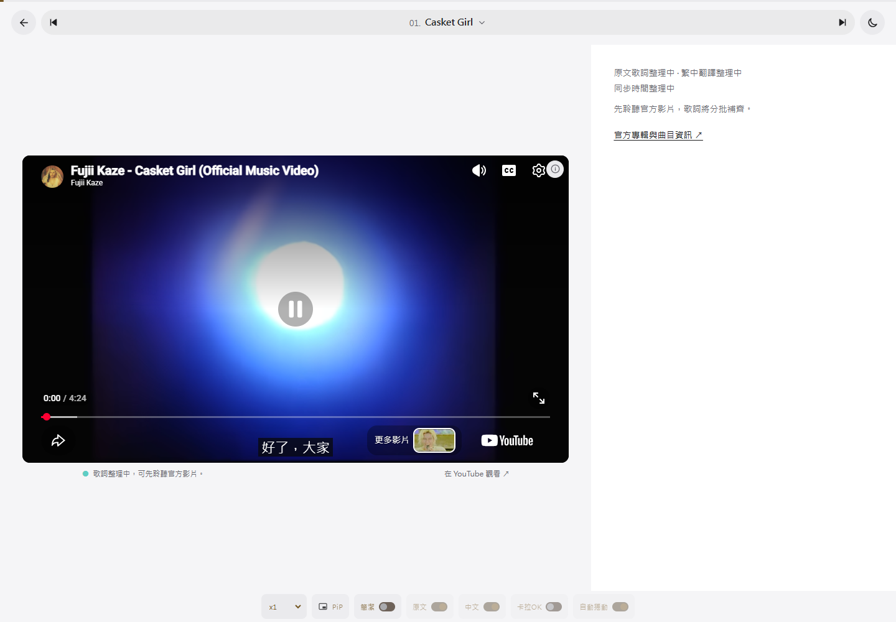
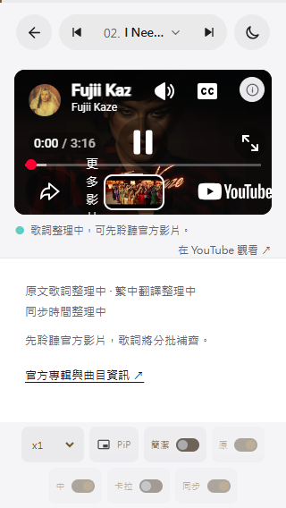

# YouTube 播放器穩定性驗證

2026-10-29（Asia/Taipei）。Playwright Core 1.61.1，實際 Edge Chromium 無頭瀏覽器。**更新後 43 項檢查全部通過，沒有瀏覽器 JavaScript 例外。**

同日後續查證更正：先前的 150 來自數字 IP 預覽來源，不足以判定影片禁止嵌入。已修正為啟動前轉至 localhost，並逐首確認 19 支影片實際播放。完整原因及證據見 [嵌入問題修正紀錄](../embed-investigation-2026-10-29/README.md)。

## 修正結果

- 歌曲開啟立即連線播放器；歌詞延遲或載入失敗不會阻止影片，也不再覆蓋影片狀態。
- 快速連續選歌只處理最後選定的歌曲；歌詞載入完成後不會重複載入或重播同一影片。
- 一般換歌保留 iframe；手動重試才重建，並忽略舊播放器的延遲回應。
- 明確區分 API 連線、影片載入、緩衝、需要手動播放、錯誤與離線。播放器 ready 不再被當作已成功播放。
- API 失敗、API／影片逾時提供重試。重試下載使用不同請求網址，避免與舊的未完成下載合併。
- 播放受阻提供「播放影片」；嵌入受限提供「在 YouTube 觀看」，正確對應目前選歌。
- 離開歌曲頁後的延遲播放事件會被暫停；恢復連線後提供手動恢復，不自行開始播放。
- 狀態提示採黑底淺色字；重試與觀看操作至少 44px 高。320px 的說明文字與外部影片連結可換行，不再重疊。

## 檢查方式與限制

[回歸腳本](../../scripts/check-player-browser.mjs) 前段以受控 YouTube API 事件測試競態、逾時、離線、來源辨識錯誤、重試及歌詞失敗；這些案例不代表 YouTube 真實串流成功。後段另外使用未替換回應的真實 YouTube API，檢查桌面／手機畫面、單一 iframe、換歌連結及新分頁開啟。

改用 localhost 後，真實 API 的〈Casket Girl〉與〈I Need U Back〉皆為 **playing**；回歸檢查現在要求正確影片的原生媒體秒數持續前進。先前只驗證錯誤處理，沒有證實播放成功，現已補上此驗收條件。

另依官方 [onAutoplayBlocked 事件](https://developers.google.com/youtube/iframe_api_reference#onAutoplayBlocked) 處理瀏覽器阻擋播放，並依 [origin 參數說明](https://developers.google.com/youtube/player_parameters#origin) 設定目前網站來源。iframe 保留行內播放、autoplay 權限及明確的來源參照政策。

附加驗證：`npm run build`、`npm run check:guide`、既有 DOM smoke、JavaScript 語法檢查與 `git diff --check` 通過。未變更歌詞、翻譯、時間碼、版本或部署設定。

## 實際畫面

1. 桌面 1440 × 1000：正常嵌入播放。



2. 手機尺寸 320 × 568：正常嵌入播放，影片下方說明及外部連結換行。



原始結果：[results.json](results.json)。瀏覽器狀態回歸可依下列方式重跑；Playwright 安裝在環境暫存／既有執行環境，不新增專案套件。

```powershell
$env:KAZE_QA_BASE_URL = 'http://localhost:4174/'
node scripts/check-player-browser.mjs '<Playwright Core index.mjs 的絕對路徑>'
```
